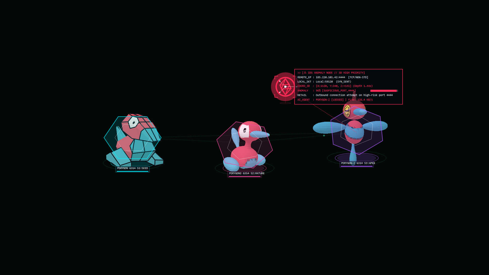
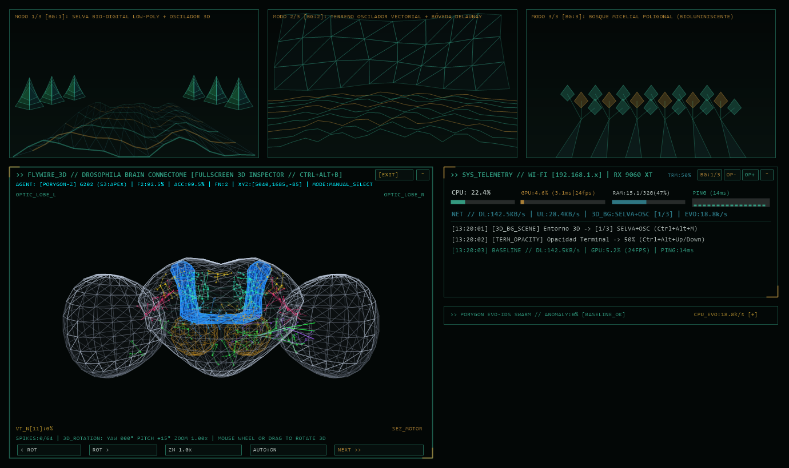

# Porygon Cyber IDS Wallpaper Suite 🦆⚡🛡️

Un **Wallpaper Animado Cyberpunk / Hacker ultraligero (~39 MB RAM)** para Windows 11 escrito en C# nativo (sin motores pesados ni dependencias externas) que integra un **Enjambre Autónomo 3D de las 3 evoluciones de Porygon (`Porygon`, `Porygon2` y `Porygon-Z`)** impulsados por una **Red Neuronal Spiking (inspirada en el conectoma de `snedea/flybrain`)** con aprendizaje Hebbiano y **Detección Estadística de Anomalías de Red (IDS) en tiempo real**.





---

## ✨ Características Principales

### 1. 🧠 Enjambre 3D Autónomo (`X, Y, Z`) y Conectoma Anatómico 3D (`FlyWire Drosophila`)
* **Navegación Espacial 3D Completa (`X, Y, Z`):** Tanto los 3 Porygon (`Porygon`, `Porygon2` y `Porygon-Z`) como los nodos/paquetes de red navegan con coordenadas tridimensionales completas ($Z \in [-240, +240]$), escalado de perspectiva real, sombras proyectadas en el suelo 3D y telemetría `XYZ:[x,y,z]`.
* **Inspector Anatómico 3D del Conectoma (`>> FLYWIRE_3D // DROSOPHILA BRAIN CONNECTOME`):**
  * Malla cortical 3D anatómica de alta densidad (~496 triángulos) que modela el cerebro de *Drosophila* (*Central Brain*, *Optic Lobes L/R*, *Mushroom Body Calyx & Pedunculus* en azul eléctrico y *Antennal Lobe Glomeruli* en ámbar).
  * **64 Neuronas Spiking Confinadas Anatómicamente:** Somas neuronales con arborizaciones dendríticas y tractos sinápticos curvos (Bézier 3D) estrictamente contenidos dentro de la corteza 3D.
  * **Rotación 3D Interactiva y Pantalla Completa:** Rota la cámara 3D arrastrando con el mouse o con la rueda del ratón (`Yaw` / `Pitch` / `Zoom`), o ábrelo en **Pantalla Completa (`[FULL]` / `Ctrl + Alt + B`)**.

### 2. 🌲 3 Entornos 3D Procedurales de Fondo (`Vértices + Polígonos + Oscilador`)
Construidos en OpenGL con geometría poligonal (`GL_TRIANGLES`, `GL_LINE_STRIP`, `GL_LINES`) y paleta **Eye-Care Mate** (reducción del 35%–40% de fatiga visual, sin líneas púrpuras saturadas). Alternables en vivo con **`Ctrl + Alt + M`** o el botón **`[BG:1/3]`**:
1. **Modo 1/3 (`[BG:1]` — `SELVA+OSC`):** *Híbrido Selva Bio-Digital Low-Poly + Suelo de Oscilador 3D* (7 bandas de oscilador 3D con oclusión poligonal musgo oscuro + árboles facetados *low-poly* + lianas segmentadas con esporas bioluminiscentes).
2. **Modo 2/3 (`[BG:2]` — `TOPO+MESH`):** *Terreno de Oscilador Vectorial + Bóveda de Triángulos Delaunay* (9 crestas topográficas de oscilador vectorial moduladas por la red + bóveda superior geodésica 3D de triángulos Delaunay).
3. **Modo 3/3 (`[BG:3]` — `MYCELIUM`):** *Bosque Micelial Poligonal Bioluminiscente* (Troncos poligonales 3D ramificados desde suelo y techo + racimos de cristales octaédricos facetados y pulsos bioluminiscentes).

### 3. 🌧️ Lluvia de Logs 100% Vertical con Profundidad 3D y 7 Categorías Semánticas
* **Texto 100% Vertical Garantizado:** Cada columna renderiza caracteres apilados verticalmente con seguimiento por columna.
* **3 Planos de Profundidad 3D (`DepthLayer 0, 1, 2`):** Efecto paralaje real con diferentes escalas, velocidades y niveles de contraste sobre fondo obsidiana.
* **7 Colores Semánticos Mate:**
  * 🔴 **Carmesí Terracota:** Alertas críticas IDS / Intrusiones (+34% velocidad de caída).
  * 🟡 **Oro Solar Mate:** Inteligencia de amenazas **VirusTotal v3** (+34% velocidad de caída).
  * 🟠 **Ámbar Cobre:** Eventos de Firewall **FortiGate** / IPS.
  * 🌸 **Rosa Coral Mate:** Anomalías estadísticas NIDS / NDR y Z-Score.
  * 🩵 **Cian Salvia Fósforo:** Flujos activos TCP / TLS / HTTPS / DNS.
  * 🟢 **Esmeralda Bosque:** Tráfico verificado limpio / Línea base saludable.
  * 💠 **Verde Azulado Bio-Teal:** Neuro-evolución del enjambre Porygon y poda sináptica.

### 4. ⚡ Monitoreo de GPU en Tiempo Real y Gobernador Adaptativo Eco-GPU
* **Telemetría de Hardware en Vivo (`>> SYS_TELEMETRY`):** Muestra carga de `CPU`, **`GPU: XX.X% (X.Xms | XXfps)`** (muestreando los motores 3D de hardware vía `\GPU Engine(*)\Utilization Percentage`), `RAM` y latencia `PING`.
* **Gobernador Adaptativo Eco-GPU:** Corre a **24 FPS** cuando interactúas con el escritorio o el cerebro 3D, y reduce automáticamente a **15 FPS (`[15eco]`)** cuando trabajas en cualquier aplicación en primer plano, reduciendo la carga combinada de GPU en más de un **85%** en configuraciones multimonitor.

### 5. 🛡️ Detección Real de Anomalías de Tráfico (Network IDS) + VirusTotal v3
Los 3 modelos se alimentan cada ciclo con telemetría real del stack de red de Windows (`IPGlobalProperties.GetActiveTcpConnections()`, estadísticas IPv4 de tu interfaz activa y latencia ICMP), además de auditoría automática de IPs públicas en **VirusTotal API v3**.

---

## ⌨️ Atajos de Teclado Globales
| Atajo | Acción |
| :--- | :--- |
| **`Ctrl + Alt + W`** | Abre el **Panel de Configuración en Vivo** (Tema de color, Entorno 3D de fondo, velocidad de lluvia, tamaño 3D, etc.). |
| **`Ctrl + Alt + M`** | Alterna en vivo entre los **3 Entornos 3D Procedurales de Fondo** (`SELVA+OSC` $\rightarrow$ `TOPO+MESH` $\rightarrow$ `MYCELIUM`). |
| **`Ctrl + Alt + B`** | Abre / cierra el **Inspector del Conectoma 3D FlyWire en Pantalla Completa**. |
| **`Ctrl + Alt + P`** | Lanza una **Simulación / Oleada de Anomalías IDS** para entrenar a los 3 Porygon en vivo. |
| **`Ctrl + Alt + Up / Down`** | Aumenta o disminuye globalmente la **opacidad de Windows Terminal** (±10%, también disponible con `Ctrl + Shift + Up/Down` dentro de la terminal o botones `[OP-]`/`[OP+]` en el HUD). |

---

## 🚀 Compilación e Instalación Rápida (Sin dependencias externas)

El proyecto utiliza el compilador nativo de .NET Framework incluido en Windows (`csc.exe`):

```powershell
# Compilar e instalar automáticamente en %LOCALAPPDATA%\Programs\HackerWallpaper
powershell -ExecutionPolicy Bypass -File .\scripts\install.ps1
```

## 📁 Estructura del Repositorio
* `src/HackerWallpaper.cs` — Motor principal OpenGL + GDI+ del Wallpaper, 3 Entornos 3D Poligonales, Renderizador 3D GLB, Conectoma Anatómico 3D `FlyBrainConnectome`, Detector Estadístico IDS, Integración VirusTotal v3 y Radar 360°.
* `src/HackerLockScreen.cs` — Protector / Pantalla de bloqueo animada Cyberpunk.
* `src/TrayAutoHide.cs` — Utilidad ligera para auto-ocultar iconos secundarios de la bandeja del sistema sin alterar la composición DWM (`Shell_TrayWnd`).
* `Models/` — Modelos 3D `.glb` de `Porygon`, `Porygon2` y `Porygon-Z`.
* `scripts/` — Scripts de compilación (`build.ps1`), instalación (`install.ps1`) y generación de iconos Fluent Dark (`generate_fluent_icons.py`).
* `terminal/cyberpunk-neon.omp.json` — Tema Cyberpunk Neón para Windows Terminal + Oh My Posh.
* `docs/plan_optimizacion_rendimiento.md` — Plan y guía de optimización de rendimiento y red para Windows 11.
